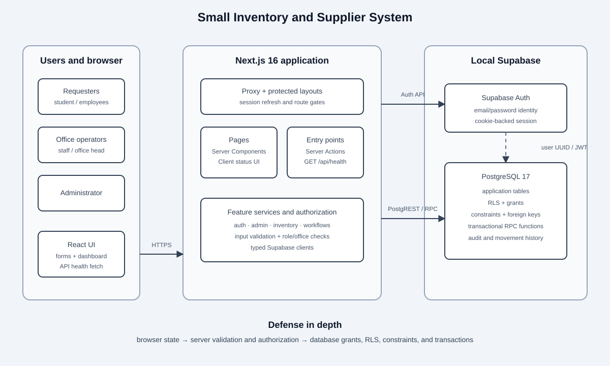

# SISS Integration Plan v2

**Checkpoint:** IT305 Midterm Integration Checkpoint
**Repository state reviewed:** 2026-10-22
**Deployment boundary:** local development environment

## Purpose and users

SISS centralizes inventory, requests, circulation, incidents, suppliers, and purchasing for three
school offices: the Property Custodian Office, Hospitality Management Laboratory, and Science
Laboratory. It serves students, teachers, non-teaching personnel, office staff, office heads, and
system administrators.

## Implemented architecture

The browser renders a Next.js App Router application. Server Components read data through feature
services, Server Actions validate and mutate data, and the dashboard Client Component calls the
public `GET /api/health` Route Handler. Supabase Auth establishes the user identity. PostgreSQL
stores application data and enforces grants, constraints, controlled functions, and RLS. This is a
medium architecture: entry points delegate to feature services or actions, which own Supabase
access rather than putting database operations directly in presentation components.

The SVG is the source diagram and can be placed directly in a PDF or exported to PNG with a
browser, Inkscape, or another SVG-capable editor.

## Technology stack

| Layer           | Implemented technology                     | Responsibility                                         |
| --------------- | ------------------------------------------ | ------------------------------------------------------ |
| Browser UI      | React 19, Tailwind CSS 4                   | Accessible pages, forms, status feedback               |
| Web runtime     | Next.js 16 App Router, TypeScript 6        | Routing, rendering, Route Handlers, Server Actions     |
| Session adapter | `@supabase/ssr`                            | Cookie based browser/server session handling           |
| Identity        | Supabase Auth                              | Email/password identity and session lifecycle          |
| Data API        | Supabase PostgREST/RPC                     | Typed table reads and controlled function calls        |
| Database        | PostgreSQL 17                              | Records, constraints, transactions, RLS, audit history |
| Verification    | Vitest, Testing Library, Playwright, pgTAP | Unit/component, browser, and database policy tests     |

## Data flows

### Login and authorization

1. The browser submits credentials to `signInAction`.
2. Supabase Auth verifies the credentials and returns a cookie-backed session.
3. Next.js proxy refreshes the session on navigation.
4. the protected layout loads the active profile and roles.
5. Server guards authorize the route or action; PostgreSQL RLS authorizes the data operation.

### Health API integration

1. The authenticated dashboard renders `ApiHealthStatus`.
2. The component fetches `GET /api/health` with JSON requested and caching disabled.
3. The component validates an HTTP success and `{ "status": "ok" }`.
4. It renders `System API Online`; malformed, failed, or unreachable responses render
   `System API Unavailable` without exposing internals.

### Category CRUD checkpoint

1. Authorized staff load categories visible for their assigned office; administrators see all.
2. Create and edit forms submit to server actions that validate IDs, names, office scope, and role.
3. Supabase issues parameterized insert/update/select operations.
4. RLS independently restricts the row by active role and office.
5. Delete is currently implemented as **soft deactivation** (`is_active = false`) to preserve item
   references and history. If the instructor requires a physical SQL `DELETE`, that requirement
   needs confirmation; this checkpoint does not claim physical deletion.

### Inventory and operational workflows

Reads pass through feature services and RLS. Stock changes, issuance, receiving, loan transitions,
reservation transitions, and other multi-row mutations use controlled database functions so each
operation is atomic and writes its history. User and office IDs are derived or checked at the
server/database boundary rather than trusted from the browser.

## Integration points

| Integration point           | Implemented contract                                               |
| --------------------------- | ------------------------------------------------------------------ |
| Browser to Next.js          | HTML/RSC navigation, forms, Server Actions, `GET /api/health` JSON |
| Next.js to Supabase Auth    | `signInWithPassword`, `getUser`, session refresh, sign out         |
| Next.js to database         | Supabase typed table queries and RPC calls                         |
| Auth to application schema  | Auth user triggers maintain `profiles`; roles resolve by user UUID |
| PostgreSQL security         | authenticated JWT identity feeds RLS helper functions and policies |
| Database workflow functions | transactional inventory and workflow mutations with audit/history  |

No external supplier, payment, SIS, email, or third-party data API is integrated.

## Dependencies

Runtime packages are pinned in `package.json`: Next.js, React, `@supabase/supabase-js`,
`@supabase/ssr`, CVA, clsx, and tailwind-merge. Development dependencies provide TypeScript,
Tailwind/PostCSS, ESLint, Prettier, Vitest, Testing Library, jsdom, Playwright, and the Supabase CLI.
Local operation also depends on Node.js, npm, Docker Desktop, and the local Supabase containers.

## Office-specific role access

| Capability               | Requester roles |       Office staff |     Office head |       Admin |
| ------------------------ | --------------: | -----------------: | --------------: | ----------: |
| Submit/view own requests |             Yes |                Yes |             Yes |         Yes |
| View office inventory    |              No |    Assigned office | Assigned office | All offices |
| Manage office catalog    |              No |    Assigned office | Assigned office | All offices |
| Approve office workflows |              No | Workflow dependent | Assigned office | All offices |
| Adjust stock             |              No |                 No | Assigned office | All offices |
| Manage users/offices     |              No |                 No |              No | All offices |

`student`, `teacher`, and `non_teaching` are requester roles. Office roles carry an office
assignment. Authorization is enforced in server code and RLS; navigation visibility is secondary.

## Implementation status

### Implemented locally

- Email/password login, active account checks, logout, role and office authorization
- Admin and student roles, plus teacher, non-teaching, office staff, and office head roles
- Three office records and office-scoped inventory catalog
- Category create, list, edit, and soft deactivation
- Health Route Handler and dashboard response consumer
- Stock, asset, request, approval, issue, loan/return, reservation, incident, supplier,
  procurement/receiving, notification, audit, report, and office administration workflows
- RLS enabled on exposed application tables with database policy tests

### Planned or incomplete

- Hosted Supabase configuration and production deployment
- Password recovery and production email delivery
- Private incident attachment delivery
- Scheduled notifications and production monitoring
- Configurable multi-step approvals and representative-user acceptance testing
- Instructor confirmation on whether the CRUD rubric requires physical category deletion

## Known limitations and checkpoint risks

- The local environment has critically low free disk space; heavy builds and browser runs can fail
  for environmental reasons even when targeted tests pass.
- The application has no linked hosted environment, so evidence demonstrates the local stack.
- Demo accounts are local and manually created; a database reset would remove them and is prohibited
  during checkpoint preparation.
- The health endpoint proves application API reachability, not database readiness.
- Soft deactivation retains historical referential integrity but may not meet a rubric that
  explicitly demands physical deletion.
